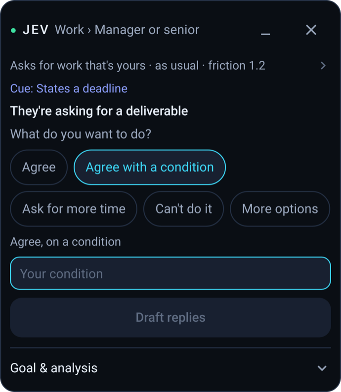
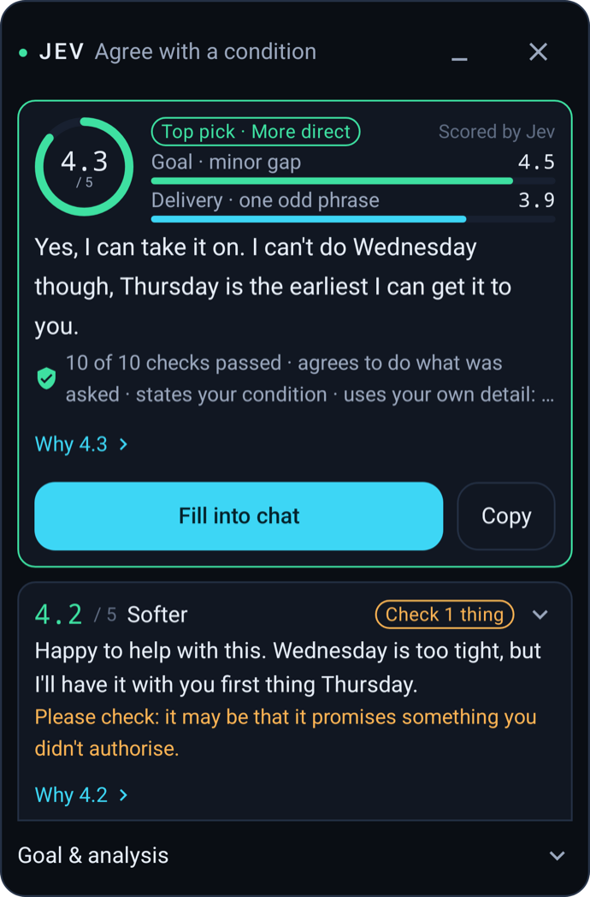

# jev-chat

### チャットの意思決定アシスタント

**まず相手を読み、それから返信する。返信する前に、Jev が相手の本当の意図、その場面のリスクの高さ、そしてどう応じるべきかを見極め、ワンタップで入力できる返信案を作成します。送信するかどうかは、常にあなたが決めます。**

### 🌐 公式サイト：**[chatjevs.com](https://chatjevs.com)**

[English](README.md) | [简体中文](README.zh-CN.md) | [Tiếng Việt](README.vi.md) | 日本語 | [Releases](https://github.com/jev-chat/jev-chat-jarvis/releases)

**[ダウンロード](#ダウンロードとインストール) · [製品](#製品) · [仕組み](#仕組み) · [プライバシー](#プライバシーとリスク) · [コミュニティ](#コミュニティとフィードバック)**

## ❤️スポンサー

> [このプロジェクトのスポンサーに興味がありますか？](#コミュニティとフィードバック)

スポンサーの表示/非表示

<table>
<tr>
<td width="240" align="center"></td>
<td>このプロジェクトをスポンサーしていただいている <b>Bocha</b> に感謝します！Bocha は AI のための検索エンジンで、アプリケーションが Web 全体の情報に、クリーンで正確かつ高品質な結果でアクセスできるようにします。サービスには、Web Search API、Bocha Jev API、その他の検索 API やモデル API があります。<a href="https://open.bocha.cn">open.bocha.cn</a></td>
</tr>
<tr>
<td width="240" align="center"></td>
<td>このプロジェクトをスポンサーしていただいている <b>Xiaoyou Store</b> に感謝します！Xiaoyou Store はデジタル製品とアカウントサービスを販売しており、このプロジェクトのユーザー向けの商品も用意しています。<a href="https://faka.rainlanguage.top">ストアを見る</a>。</td>
</tr>
<tr>
<td width="240" align="center"></td>
<td>このプロジェクトをスポンサーしていただいている <b>Vytal</b> に感謝します！Vytal は、一括制作のための再利用可能なワークフローを備えた AI 動画ワークフロープラットフォームで、コンテンツクリエイター、研修提供者、小規模なチームにとって動画制作をより身近なものにします。<a href="https://agent.ai-tools.cn">Vytal を見る</a>。</td>
</tr>
</table>

## jev-chat を選ぶ理由

メッセージが届いたとき、難しいのは入力することではありません。相手が本当は何を言いたいのか、つまり怒っているのか、試しているのか、それともただ雑談しているだけなのかを見極めることです。ほとんどの AI ツールはこのステップを飛ばして、いきなり返信を書き始めます。

**jev-chat** はまず判断します。Jev の判断モデルが会話を読み、相手の意図、その場面のリスク、最適な応じ方を見極めます。そのうえで初めて返信案を作成し、あなたが選んだものをメッセージ入力欄に入力します。

- **書く前に判断** — どの返信案よりも先に、意図、リスク、相手が求めていること、最適な行動を見極めます
- **検証され、順位付けされた返信** — すべての返信案をその判断に照らして検証し、順位付けするので、最も適したものが先頭に来ます
- **いつものチャットで使える** — Android では WhatsApp、QQ、Feishu、X、Windows と macOS ではチャットウィンドウ、iOS ではキーボードを通じてあらゆるアプリで使えます
- **送信するのはあなた** — jev-chat は入力欄に入力するだけで、勝手に送信することはありません
- **あなたのキーを使い、私たちのサーバーは介さない** — リクエストは、あなたが設定したモデルプロバイダーにのみ、あなた自身のキーで送信されます
- **オープンソース** — MIT ライセンスで、Android、Windows、macOS、iOS にわたる 5 つのアプリを提供しています

## 製品

| プラットフォーム | 製品 | 使い方 | ステータス |
| :--- | :--- | :--- | :--- |
| Android | [Jev for WhatsApp](../global/README.md)（グローバル版） | 英語の WhatsApp チャットにオーバーレイ表示 | プレビュー v0.1.0 |
| Android | [Jev Chat Assistant](../cn/README.en.md)（中国語版） | QQ、Feishu、X、WhatsApp にオーバーレイ表示 | v1.7 |
| Windows | [Jev for Windows](https://github.com/jev-chat/jev-chat-windows) | チャットウィンドウの横に表示され、スクリーンショットとデバイス上の OCR でチャットを読み取ります | リリース済み |
| macOS | [Jev for macOS](https://github.com/jev-chat/jev-chat-jarvis-mac) | 画面上のチャットを読み取り、ローカルモデルで判断するオーバーレイ | リリース済み（Apple Silicon） |
| iOS | [Jev Keyboard](https://github.com/jev-chat/jev-chat-jarvis-ios) | カスタムキーボード：メッセージをコピーすると、キーボード上で意図、リスク、返信案を確認できます | ソースのみ。各自でビルドしてください |

Android の 2 つのエディションは、どちらもこのリポジトリにあります。その他のプラットフォームには、それぞれ専用のリポジトリがあります。

## スクリーンショット

| グローバル版 · 分析 | グローバル版 · スコア付きの返信 | 中国語版 · オーバーレイ |
| :---: | :---: | :---: |
|  |  |  |

## ダウンロードとインストール

### 動作環境

- **Android**：Android 11 以降（中国語版は ARM64 のスマートフォンが必要です）
- **Windows**：Windows 10 1903 以降、または Windows 11
- **macOS**：Apple Silicon 搭載の macOS 13 以降
- **iOS**：Xcode で各自ビルドしてください

### Android をお使いの方

| | グローバル版 | 中国語版 |
| :--- | :--- | :--- |
| 対象 | WhatsApp での英語のチャット | QQ、Feishu、X、WhatsApp での中国語のチャット |
| ダウンロード | [jev-whatsapp-v0.1.0-release.apk](https://github.com/jev-chat/jev-chat-jarvis/releases/download/global-v0.1.0/jev-whatsapp-v0.1.0-release.apk) | [jev-assistant-v1.7-release.apk](https://raw.githubusercontent.com/jev-chat/jev-chat-jarvis/main/cn/apk/jev-assistant-v1.7-release.apk) |
| ガイド | [グローバル版の README](../global/README.md) | [中国語版の README](../cn/README.en.md) |

両方を同じスマートフォンにインストールできます。インストール後、アプリを開き、ガイドに従ってユーザー補助サービスとオーバーレイの権限を有効にしてください。グローバル版は [@smgonthebeat](https://github.com/smgonthebeat) が開発しています。

### Windows をお使いの方

[Releases](https://github.com/jev-chat/jev-chat-windows/releases) ページから最新版をダウンロードしてください。セットアップについては [プロジェクトの README](https://github.com/jev-chat/jev-chat-windows) をご覧ください。

### macOS をお使いの方

[Releases](https://github.com/jev-chat/jev-chat-jarvis-mac/releases) ページから最新版をダウンロードしてください。Apple Silicon のみ対応しています。セットアップについては [プロジェクトの README](https://github.com/jev-chat/jev-chat-jarvis-mac) をご覧ください。

### iOS をお使いの方

App Store 版はまだありません。[ソース](https://github.com/jev-chat/jev-chat-jarvis-ios) から Xcode でキーボードをビルドしてください。

## 仕組み

1. **読み取る。** Jev は画面上の会話を読み取ります。Android ではユーザー補助サービスを通じて、デスクトップではチャットウィンドウ（デバイス上の OCR によるスクリーンショット、またはシステムのテキスト API）から、iOS ではコピーしたメッセージから読み取ります。チャットアプリを改変したり、ログインしたりすることはありません。
2. **まず判断する。** 返信を書く前に、判断モデルが相手の本当の望み、その場面のリスクの高さ、最適な応じ方を見極めます。
3. **作成、検証、順位付け。** Jev は返信案を作成し、その判断に照らして検証し、順位付けします。1 つをタップするとメッセージ入力欄に入力されます。送信ボタンを押すのはあなたです。

## プライバシーとリスク

- Android：チャットのテキストと、あなたが有効にした背景情報は、あなたが設定したモデルプロバイダーにのみ、あなた自身のキーで送信されます。私たちはサーバーを運用しておらず、あなたのチャットを受け取ることはありません。OCR に使われるスクリーンショットがスマートフォンの外に出ることはありません。
- Windows、macOS、iOS：データの扱いについては、各プロジェクトの README をご覧ください。
- プライバシーポリシー（Android）：[グローバル版](../global/PRIVACY.md) · [中国語版](../cn/PRIVACY.md)

> **自己責任でご利用ください：** QQ、Feishu、X、WhatsApp などのサードパーティアプリ内で Jev を使用することは、それらのアプリの利用規約に違反する可能性があり、アカウントが制限または停止されるおそれがあります。使用するかどうかはご自身で判断してください。

## コミュニティとフィードバック

- グローバル版の問題：[WhatsApp のバグテンプレートで報告してください](https://github.com/jev-chat/jev-chat-jarvis/issues/new?template=whatsapp-assistant-bug.md)。
- その他のこと：[Issue を作成してください](https://github.com/jev-chat/jev-chat-jarvis/issues)。
- プルリクエストを歓迎します。新機能については、まず Issue を作成して相談してください。
- Jev が役に立ったら、このリポジトリに **Star** を付けていただけると、開発を続ける励みになります。

**ご連絡は WeChat 公式アカウントへのメッセージでお願いします。** 提携、スポンサー、フィードバックにご利用ください。その他の場所に送られたメッセージは見落とされる可能性があります。

あなたが本当に必要としていることをぜひ聞かせてください。どのチャットアプリで Jev を一番使いたいですか？何を察知し、どのように通知し、何には決して触れるべきではないでしょうか？ご意見は公式アカウントまでお送りください。

## Star History

## 著作権とライセンス

Copyright © 2026 Finderchangchang and the jev-chat contributors. コードは [MIT License](../LICENSE) の下で公開されています。[NOTICE](../NOTICE) もあわせてご覧ください。コントリビューターは [CONTRIBUTORS](CONTRIBUTORS.md) に記載されています。

- **商用利用が可能です：** 個人や企業は、支払いや事前の許可なしに、コードを使用、改変、再配布したり、自社製品に組み込んだりできます。
- **クレジットの表記が必要です：** 配布や商用利用の際は LICENSE と NOTICE を保持し、製品の About ページ、ドキュメント、リリースページで出典を明記してください。推奨する表記：`Based on Jev Chat Assistant (https://github.com/jev-chat/jev-chat-jarvis)`。
- 「Jev Chat Assistant」（「Jev 聊天助手」）や「jev-chat」という名称、またはドメイン chatjevs.com を、あなたの製品が原作者によって作られた、または推奨されていると示唆する目的で使用しないでください。

**免責事項：** このプロジェクトは、あなた自身のデバイス上で、閲覧する権限のある会話のみを処理します。QQ、X、Feishu、WhatsApp など、使用するすべてのアプリの利用規約と、適用される現地の法令を遵守してください。作者は、その使用によって生じたいかなる結果についても責任を負いません。
